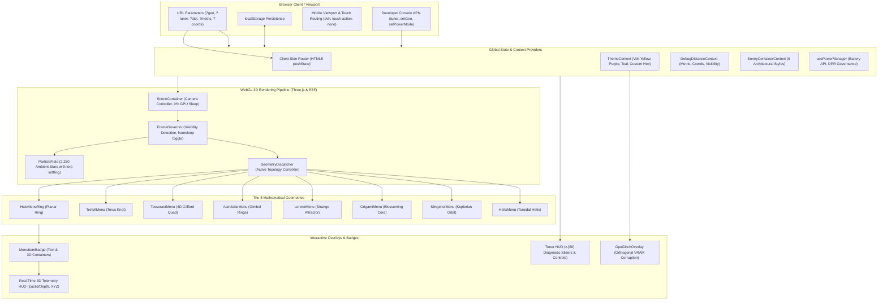

# Antigravity Engineering Chronicles & Developer Documentation

Welcome to the internal engineering documentation and technical chronicles for `trongngyn.com` (`trongable.github.io`). This repository houses an interactive 3D mathematical geometry laboratory, cyber visual effects engine, and personal web platform deployed to GitHub Pages.

---

## 🧭 Navigation & Document Directory

### 📖 [The Tuner Manual & Calibration Guide](./tuner-manual.md)
The exhaustive reference manual covering all developer system HUD controls:
- **Geometry Parameters**: Real-time animation speeds, radii, scales, chaos parameters, wireframe toggles, and reset defaults for all 8 topologies.
- **Procedural Guides**: 7 render styles (`solid`, `cage`, `glow`, `hex`, `dash`, `dots`, `ribbed`).
- **Sonny 3D Containers**: 6 architectural container styles (`capsule`, `diorama`, `pedestal`, `wirebox`, `crystal`, `none`).
- **Real-Time 3D Telemetry HUD**: Dual spatial metrics (`Euclid (d:)` vs `View Depth (z:)`) and 3D $(X, Y, Z)$ coordinate readouts.
- **VFX & Glitch Engine**: Color science presets, custom hex pickers, relative luminance-derived highlight preview, theme locking, and interval sliders.
- **Power & Performance Governance**: `Auto`, `Eco`, and `Uncapped` battery and refresh rate modes.
- **Developer Console Commands & URL Flags**: Complete cheat sheet for console APIs, query parameters, and `localStorage` keys.

---

### 🏛️ The Engineering Chronicles (Chronological Order)

A chronological collection of deep-dive post-mortems and technical whitepapers detailing the mathematical, architectural, and graphics challenges solved across the repository's lifecycle:

| Chapter | Title | Timeline / Focus | Math Level |
| :---: | :--- | :--- | :---: |
| **[01](./chronicles/01-procedural-topologies-and-manifolds.md)** | **Procedural 3D Topologies & Mathematical Manifolds** | *Milestone 1*: Halo, Torus Knots, Lorenz Attractor, Keplerian Slingshot, 4D Hypercube, Toroidal Helix, Origami Icosahedron. | **Extreme** |
| **[02](./chronicles/02-mobile-touch-and-viewport-architecture.md)** | **Mobile Touch Architecture & Viewport Stabilization** | *Milestone 2*: `100dvh` viewport, overscroll locking, synthetic touch drag raycasting, tap target scaling. | Systems |
| **[03](./chronicles/03-cyber-gpu-glitch-vfx-and-memory-corruption.md)** | **Cyber GPU Glitch VFX & Orthogonal Memory Corruption** | *Milestone 3*: Procedural 90° orthogonal VRAM corruption, difference blending, nostalgic memory masking, a11y. | Graphics |
| **[04](./chronicles/04-dynamic-theming-color-science-and-tuner-hud.md)** | **Dynamic Theming, Color Science & Developer System Tuner HUD** | *Milestone 4*: CIE 1931 relative luminance, sRGB linear contrast math, theme locking, elevated HUD. | High |
| **[05](./chronicles/05-zero-allocation-and-energy-governance.md)** | **Zero-Allocation Rendering & Energy Governance** | *Milestone 5*: 0% GPU idle sleep, zero `useFrame` GC heap allocations, quadratic DPR energy math, Node.js watcher CPU thrashing fix. | Systems |
| **[06](./chronicles/06-sonny-3d-containers-and-turntable-animation.md)** | **Sonny 3D Character Containers & Turntable Animation** | *Milestone 6*: 6 architectural container styles, 15-frame turntable flipbook, zero-re-render texture cycling. | Graphics |
| **[07](./chronicles/07-pure-optical-perspective-scaling.md)** | **Pure Optical Perspective Scaling & Layer Sorting** | *Milestone 7*: Pinhole projection matrix, apparent angular diameter, quadratic double-perspective flaw proof, depth sorting. | **Extreme** |
| **[08](./chronicles/08-tesseract-4d-degeneracy-and-clifford-quad.md)** | **4D Tesseract Degeneracy & The Clifford Quad Fix** | *Milestone 8*: $SO(4)$ dual-plane rotations, rank 2 planar collapse proof, Balanced Clifford Quad derivation. | **Extreme** |
| **[09](./chronicles/09-realtime-3d-telemetry-hud-and-coordinates.md)** | **Real-Time 3D Telemetry HUD & Spatial Metrics** | *Milestone 9*: Camera coordinate frame, 25.1° downward pitch skew derivation, Euclid vs Depth, center-aligned XYZ. | **Extreme** |

---

## 📐 System Architecture Overview

