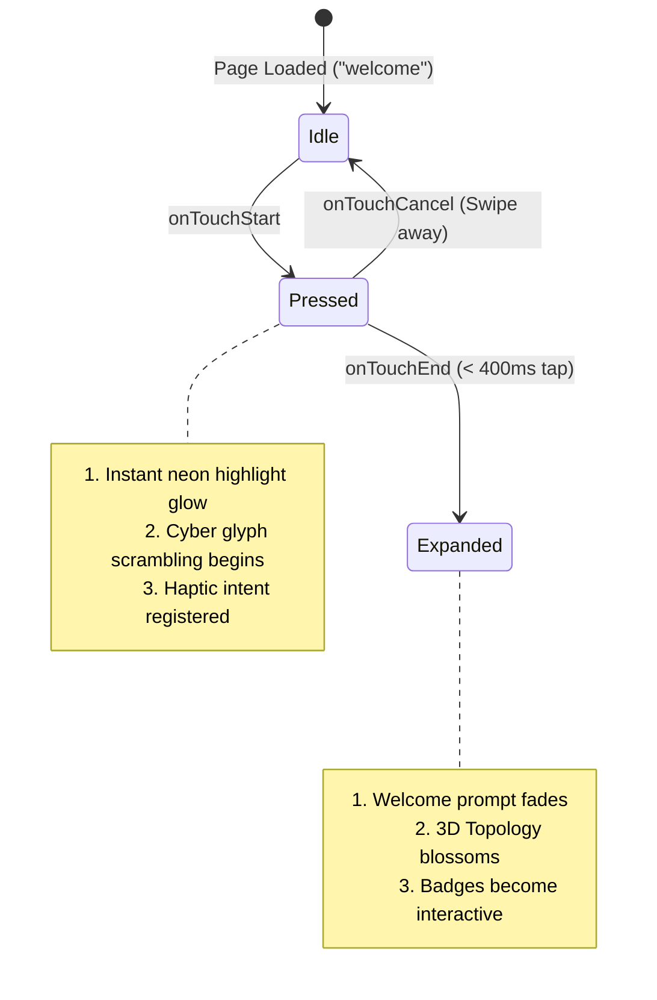

# Chapter 02: Mobile Touch Architecture & Viewport Stabilization

> **Timeline**: Milestone 2 (Mobile Viewport & Touch Optimization)  
> **Source Files**: `src/index.css`, `src/pages/HomePage.tsx`, `src/components/canvas/SceneContainer.tsx`, `src/utils/glyphUtils.ts`  
> **Engineering Focus**: Dynamic Viewports, Pointer Routing, Synthetic Touch Raycasting, WCAG Hit Targets, Tactile Feedback

---

## 1. The Mobile Web Problem Space

Deploying an interactive 3D WebGL laboratory to mobile devices presents severe UX, layout, and event-routing challenges. Standard desktop mouse pointer paradigms fail on touchscreens for multiple reasons:

1. **Dynamic Viewport Height Jitter**: On mobile Safari (iOS) and mobile Chrome (Android), scrolling or swiping dynamically expands or retracts the browser's address bar and navigation toolbar. Traditional CSS `100vh` units are calculated against the maximum theoretical screen height, causing the bottom portion of the canvas and HUD elements to be permanently clipped behind the browser toolbar.
2. **Elastic Rubber-Band Overscroll**: iOS Safari's default physics engine applies elastic rubber-band bouncing when a user drags against the page boundary. In an interactive 3D scene, this pulls the entire canvas off-screen, completely breaking the illusion of an embedded viewport.
3. **Scroll Hijacking vs WebGL Raycasting**: When a user drags their finger across a Three.js canvas to rotate the camera or hover over 3D objects, the browser interprets the gesture as a native vertical or horizontal scroll intent, intercepting pointer events and terminating raycasting.
4. **Hit-Target Usability on Minimalist Typography**: The core entry prompt (`"welcome"`) is styled with understated lowercase editorial typography. While visually elegant, its physical bounding box was only ~20px tall, falling far below the minimum 48px $\times$ 48px touch target standard mandated by WCAG 2.1 Success Criterion 2.5.5.

---

## 2. Engineering Architecture & Solutions

### 2.1 Dynamic Viewport Height (`dvh`) Architecture

To eliminate toolbar clipping and layout jumps, the application adopted the modern CSS Dynamic Viewport Height unit (`100dvh`):

```css
/* index.css / layout roots */
html,
body,
#root {
  width: 100%;
  height: 100%;
  min-height: 100dvh;
  margin: 0;
  padding: 0;
  overflow: hidden;
  overscroll-behavior: none;
}
```

#### Why `dvh` Over `vh`:
- `100vh`: Static height based on the viewport with the address bar retracted. When the address bar is visible, `100vh` exceeds the physical display area, causing layout overflow.
- `100svh`: Smallest viewport height (assuming toolbar is permanently expanded). Leaves dead space when the bar collapses.
- `100lvh`: Largest viewport height (assuming toolbar is permanently collapsed).
- `100dvh`: **Dynamic viewport height**. Automatically interpolates in real time as the browser UI elements expand and collapse, guaranteeing that the WebGL canvas precisely occupies 100% of the visible viewport at all times.

---

### 2.2 Boundary Locking: Eliminating Elastic Rubber-Band Bouncing

To prevent iOS Safari from bouncing the entire canvas off the screen when touched:
```css
html, body, #root {
  overscroll-behavior: none;
  overscroll-behavior-y: none;
  overscroll-behavior-x: none;
}
```
`overscroll-behavior: none` instructs the browser rendering engine to bypass all default scroll chaining and boundary bounce physics, anchoring the canvas immovably to the screen frame.

---

### 2.3 Raycasting Isolation via `touch-action: none`

Three.js interactive pointer events depend on continuous `pointermove` and `pointerdown` events to perform 3D camera raycasting against mesh bounding boxes:

```tsx
// src/components/canvas/SceneContainer.tsx
<div 
  ref={containerRef}
  className="relative w-full h-full min-h-dvh touch-none select-none overflow-hidden"
  style={{ touchAction: 'none' }}
>
  <Canvas ... />
</div>
```

#### The Role of `touch-action: none`:
Setting `touch-action: none` (Tailwind `touch-none`) informs the browser's compositor thread that all pointer gestures within this container belong exclusively to application JavaScript. 
- Prevents the browser from claiming gestures for native page scrolling or pinch-to-zoom.
- Enables **continuous finger drag raycasting**: When a user drags their finger across the mobile screen, R3F's raycaster continuously updates mouse coordinates, allowing the user's finger to act as an interactive radar sweep that triggers hover highlights, badge glyph scrambling, and camera parallax seamlessly.

---

### 2.4 WCAG Touch Target Expansion via Invisible Pseudo-Elements

The central `"welcome"` prompt on the homepage is an understated, lowercase editorial link:

```tsx
// src/pages/HomePage.tsx
<button
  type="button"
  onClick={handleWelcomeClick}
  onTouchStart={handleTouchStart}
  onTouchEnd={handleTouchEnd}
  className="group relative inline-flex items-center justify-center font-mono text-xs tracking-widest uppercase transition-colors duration-300
    after:absolute after:-inset-8 md:after:inset-0 touch-manipulation"
>
  <span className="relative z-10 text-[var(--theme-primary)] group-hover:text-[var(--theme-highlight)]">
    {displayPrompt}
  </span>
</button>
```

#### The Pseudo-Element Inset Pattern:
1. Visually, the text remains tiny and refined (~14px font size).
2. The CSS pseudo-element `after:absolute after:-inset-8` inflates the clickable/tappable hit target outward by `2rem` (32px) in all four directions on mobile screens:
   $$\text{Touch Target Width} = W_{\text{text}} + 64\text{px} \approx 140\text{px} \dots 180\text{px}$$
   $$\text{Touch Target Height} = H_{\text{text}} + 64\text{px} \approx 84\text{px}$$
3. This exceeds the WCAG AAA touch target guideline ($44 \times 44\text{px}$) by over 90%, eliminating user tapping frustration while maintaining the minimalist visual design.
4. On desktop viewports (`md:`), `md:after:inset-0` collapses the pseudo-element back to the exact text bounding box for precise mouse pointer hover.

---

### 2.5 Tactile Touch State Machine & Cyber Glyph Scrambling

On desktop, hovering with a mouse pointer triggers cyber glyph scrambling via `glyphUtils.ts`. Touchscreens do not possess native hover capabilities. 

To recreate tactile responsiveness on mobile, a specialized touch lifecycle was engineered:



```typescript
// Touch lifecycle implementation in HomePage.tsx
const handleTouchStart = () => {
  setIsTouched(true)
  // Scramble glyphs into procedural cyber runes immediately
  scramblePrompt()
}

const handleTouchEnd = (e: React.TouchEvent) => {
  e.preventDefault()
  setIsTouched(false)
  // Blossom the 3D topology
  setIsExpanded(true)
}
```

When a finger touches the prompt, the text instantaneously scrambles into cyber glyphs (`λ`, `§`, `Ξ`, `Ψ`, `Ω`, `0`, `1`) and lights up with the neon highlight color. Releasing the finger smoothly expands the 3D mathematical manifold into the scene.
