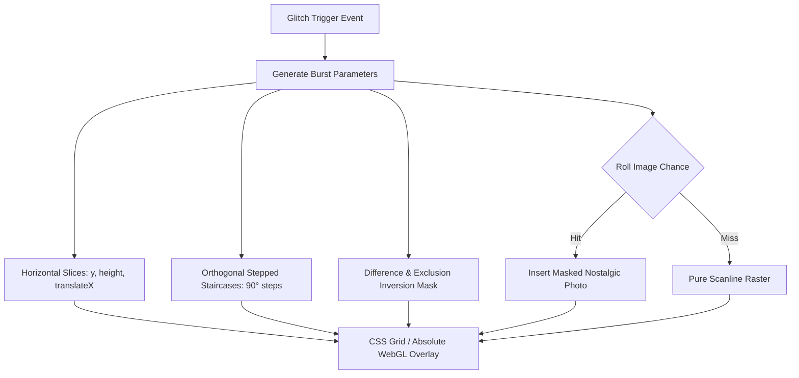

# Chapter 03: Cyber GPU Glitch VFX & Orthogonal Memory Corruption

> **Timeline**: Milestone 3 (Visual FX & Glitch Engine)  
> **Source Files**: `src/components/effects/GpuGlitchOverlay.tsx`, `src/context/ThemeContext.tsx`  
> **Engineering Focus**: Procedural VRAM Simulation, Strict 90° Orthogonality, Blend Mode Mathematics, Accessible Motion Governance

---

## 1. The Design Philosophy: Escaping Web Glitch Clichés

Most web-based "cyber" or "glitch" visual effects rely on dated 2010s tropes:
- Diagonal CSS transforms (`transform: skewX(-15deg)`)
- Multi-colored chromatic aberration RGB split filters
- Video background loops with pre-rendered analog VHS static tape noise

These techniques look dated, feel non-procedural, and contradict the mathematical, digital nature of the repository. 

### The Requirement: Strict Orthogonality
A true simulated GPU memory corruption or VRAM address line bus fault operates strictly along digital hardware registers: **horizontal scanlines, memory address blocks, and rectangular buffer displacements**. Therefore, the glitch engine was architected under a zero-tolerance geometric rule:
> **100% strictly orthogonal (90° right angles). Exactly zero diagonal slices, zero trapezoids, zero sheared polygons, zero curved artifacts.**

---

## 2. Procedural Architecture & Geometry Generation

### 2.1 Orthogonal Block & Staircase Synthesis

During an active glitch burst, the overlay generates a dynamic set of procedural artifact elements:



#### Orthogonal Staircase Decomposition:
Rather than shearing geometry diagonally, staircases are synthesized as a series of strictly orthogonal rectangular blocks descending or ascending in discrete mathematical steps:

```typescript
// Synthesizing 90° right-angle stepped staircase blocks
const steps = Math.floor(4 + Math.random() * 5)
const stepWidth = 100 / steps
const baseHeight = 12 + Math.random() * 18 // percentage
const startY = Math.random() * (100 - baseHeight)

for (let s = 0; s < steps; s++) {
  const rect = {
    left: `${s * stepWidth}%`,
    top: `${startY + (s % 2 === 0 ? s * 2 : -s * 1.5)}%`,
    width: `${stepWidth * (1 + Math.random() * 0.4)}%`,
    height: `${baseHeight * (0.6 + Math.random() * 0.8)}%`,
  }
  // Render strictly as rectangular divs with zero rotation
}
```

Every generated shape is an axis-aligned bounding box (AABB), ensuring the visual texture mimics hardware-level frame buffer tearing.

---

### 2.2 Blend Mode Mathematics & Inversion Masks

To create blinding neon bursts that interact organically with the underlying WebGL canvas, the glitch overlay utilizes hardware CSS blend modes:

#### 1. Difference Mode (`mix-blend-mode: difference`):
Calculates the absolute difference between the active theme color $\vec{C}_{\text{fg}}$ and the background canvas $\vec{C}_{\text{bg}}$:

$$\vec{C}_{\text{result}} = |\vec{C}_{\text{fg}} - \vec{C}_{\text{bg}}|$$

- When overlapping black (`#000000`), the color is unchanged: $|C - 0| = C$.
- When overlapping white (`#ffffff`), the color is inverted: $|C - 1| = 1 - C$.
- When overlapping identical colors, it yields pure pitch black: $|C - C| = 0$.

#### 2. Exclusion Mode (`mix-blend-mode: exclusion`):
Produces a lower-contrast, ethereal inversion curve:

$$\vec{C}_{\text{result}} = \vec{C}_{\text{fg}} + \vec{C}_{\text{bg}} - 2 \vec{C}_{\text{fg}} \vec{C}_{\text{bg}}$$

This dynamic mathematical color inversion produces high-voltage neon flashes without requiring expensive post-processing bloom shaders.

---

## 3. Nostalgic Glitch Memory Photos

Masked within the orthogonal rectangular glitch boundaries, nostalgic personal memory photos (`/images/glitch/memory-01.jpg`, etc.) appear at a configurable rate:

```tsx
<div 
  className="absolute overflow-hidden"
  style={{
    top: `${photoSlice.top}%`,
    left: `${photoSlice.left}%`,
    width: `${photoSlice.width}%`,
    height: `${photoSlice.height}%`,
  }}
>
  
</div>
```

1. **High Contrast Inversion**: Photos are filtered with `contrast(200%) grayscale(100%) invert(100%)`.
2. **Difference Blending**: Difference blending causes the photo to emerge from the black void like an exposed photographic negative burned into VRAM silicon.
3. **Hardware Acceleration**: Transform offsets and scale mutations run on GPU compositor layers, guaranteeing zero dropped frames during 120Hz display refresh.

---

## 4. Accessibility & Motion Governance (`prefers-reduced-motion`)

Fullscreen flashing effects and rapid visual displacements pose severe risks for individuals with vestibular disorders, photosensitive epilepsy, or visual motion sensitivities.

The glitch engine implements an un-bypassable accessibility safety mechanism:

```typescript
// Listening to native operating system accessibility preference
useEffect(() => {
  const mediaQuery = window.matchMedia('(prefers-reduced-motion: reduce)')
  
  const handleMotionPreference = (e: MediaQueryListEvent | MediaQueryList) => {
    setIsMotionReduced(e.matches)
  }

  handleMotionPreference(mediaQuery)
  mediaQuery.addEventListener('change', handleMotionPreference)
  return () => mediaQuery.removeEventListener('change', handleMotionPreference)
}, [])

// If reduced motion is requested, suppress 100% of glitch bursts
if (isMotionReduced) {
  return null
}
```

When an operating system (macOS, iOS, Windows, Android) has "Reduce Motion" enabled:
- The glitch timer loop is suspended immediately.
- The `GpuGlitchOverlay` component renders `null`, generating zero DOM nodes and consuming 0.0% CPU/GPU resources.
- Themes remain stable and static.
