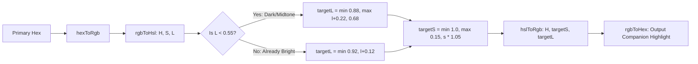

# Chapter 04: Dynamic Theming, Color Science & Developer System Tuner HUD

> **Timeline**: Milestone 4 (Theming & Diagnostic HUD)  
> **Source Files**: `src/context/ThemeContext.tsx`, `src/utils/colorUtils.ts`, `src/components/ui/Tuner.tsx`  
> **Mathematical Rigor**: **High** (CIE 1931 Luminance, sRGB Gamma Expansion, Contrast Ratios, HSL Color Metrics)

---

## 1. The Design Challenge: Procedural Color Without Aesthetic Chaos

The site features procedural fullscreen glitch bursts that periodically mutate the visual landscape. Early prototypes simply randomized hexadecimal colors. This naive approach failed catastrophically:
1. **Low Contrast Unreadability**: Randomly generated colors frequently lacked sufficient contrast against dark background elements (`#1c1b22`), violating accessibility guidelines and rendering editorial text illegible.
2. **Clashing Highlight Overlays**: Interactive badges, particle stars, and glow rings require a primary base color and an aligned "highlight" companion color. Pairings generated without color science produced jarring, discordant clashes.
3. **Loss of Developer Customization**: When developers tuned an exact custom hex palette to preview a specific brand aesthetic, the very next automated glitch burst wiped out their settings.

---

## 2. Color Science & Mathematical Foundations

### 2.1 The CIE 1931 Relative Luminance Model

To determine the perceived brightness of any color on a digital screen, the human eye's non-linear spectral sensitivity must be accounted for. The eye is far more sensitive to green photons ($555\text{ nm}$) than to blue or red.

#### 1. sRGB Gamma Linearization (De-Gamma):
Screen colors are encoded with an sRGB non-linear gamma transfer function ($\gamma \approx 2.2$). Before calculating luminance, non-linear 8-bit channel values $C \in [0, 255]$ must be expanded into linear photometric space $C_{\text{linear}} \in [0, 1]$:

$$v = \frac{C}{255}$$

$$C_{\text{linear}} = \begin{cases}
\dfrac{v}{12.92} & \text{if } v \le 0.03928 \\[8pt]
\left(\dfrac{v + 0.055}{1.055}\right)^{2.4} & \text{if } v > 0.03928
\end{cases}$$

#### 2. Photometric Weighting:
Linearized RGB channels are then multiplied by the CIE 1931 photopic luminous efficiency coefficients:

$$Y = 0.2126 \cdot R_{\text{linear}} + 0.7152 \cdot G_{\text{linear}} + 0.0722 \cdot B_{\text{linear}}$$

This value $Y \in [0, 1]$ represents the exact relative luminance of the color.

---

### 2.2 WCAG Contrast Ratio Formulation

The contrast ratio between a foreground color with luminance $L_1$ and a background color with luminance $L_2$ (where $L_1 > L_2$) is defined by the W3C Web Content Accessibility Guidelines:

$$\text{Contrast Ratio} = \frac{L_1 + 0.05}{L_2 + 0.05}$$

The constant offset $+0.05$ accounts for ambient flare and pupil adaptation on dark displays. 

```typescript
export function getContrastRatio(fgHex: string, bgHex: string = '#1c1b22'): number {
  const l1 = getRelativeLuminance(fgHex)
  const l2 = getRelativeLuminance(bgHex)
  const lighter = Math.max(l1, l2)
  const darker = Math.min(l1, l2)
  return Number(((lighter + 0.05) / (darker + 0.05)).toFixed(1))
}
```

Against the site's dark background (`#1c1b22`, $L \approx 0.012$), a color requires a relative luminance $Y \ge 0.17$ to achieve the minimum WCAG AA contrast threshold of $4.5:1$.

---

### 2.3 Automatic Companion Highlight Derivation

When a user inputs a custom primary color or a theme switch occurs, `computeHighlightColor(primaryHex)` algorithmically synthesizes a companion glow color that preserves the exact tonal identity (Hue $H$) while guaranteeing vibrant luminosity.



#### Algorithm:
1. Convert sRGB $\to$ HSL:
   $$L = \frac{\max(r, g, b) + \min(r, g, b)}{2}$$
2. Adapt Lightness $L_{\text{target}}$:
   $$L_{\text{target}} = \begin{cases}
   \min\big(0.88, \; \max(L + 0.22, \; 0.68)\big) & \text{if } L < 0.55 \\
   \min(0.92, \; L + 0.12) & \text{if } L \ge 0.55
   \end{cases}$$
3. Boost Saturation $S_{\text{target}}$:
   $$S_{\text{target}} = \min\big(1.0, \; \max(0.15, \; S \times 1.05)\big)$$
4. Convert back to RGB hex string.

This guarantees that whether a user inputs deep navy blue (`#001155`) or electric green (`#00ff66`), the highlight companion will always produce a crisp, glowing neon aura that maintains contrast readability.

---

## 3. Dynamic Theming via CSS Custom Properties

Themes mutate reactively across the entire application through CSS Custom Variables injected into the document root:

```tsx
// src/context/ThemeContext.tsx
useEffect(() => {
  const root = document.documentElement
  root.style.setProperty('--theme-primary', currentTheme.primary)
  root.style.setProperty('--theme-highlight', currentTheme.highlight)
}, [currentTheme])
```

WebGL shaders, R3F materials, SVG overlays, and Tailwind UI components reference these properties uniformly:
```css
/* Real-time neon text and border glow */
color: var(--theme-primary);
text-shadow: 0 0 12px var(--theme-highlight);
border-color: var(--theme-primary);
```

---

## 4. Theme Locking Architecture (`lockTheme`)

To prevent automated glitch bursts from overwriting user-configured palettes:

```typescript
const [isLocked, setIsLocked] = useState(false)

const handleGlitchComplete = () => {
  if (isLocked) {
    // Preserve custom primary and highlight colors
    return
  }
  // Otherwise cycle randomly to next preset theme
  cycleRandomTheme()
}
```

The lock state is controllable via:
- Tuner HUD toggle switch (`Theme Lock`).
- DevTools console: `lockTheme(true)`.

---

## 5. Developer System Tuner HUD Architecture

The Tuner HUD (`src/components/ui/Tuner.tsx`) is architected as an in-browser calibration suite:

1. **Z-Index Layering (`z-[60]`)**:
   Standard UI dialogs sit at `z-50`. Because the `GpuGlitchOverlay` occupies `z-50` during fullscreen memory corruption bursts, the Tuner HUD is elevated to `z-[60]` with `pointer-events: auto`, ensuring developers can always operate sliders even during catastrophic visual glitches.
2. **Bi-Directional State Synchronization**:
   Sliders update React component state, which directly mutates Three.js `useRef` parameter objects in the render loop without triggering full React DOM tree re-renders.
3. **Global Window API Exposure**:
   Diagnostic commands (`tuner()`, `setTheme()`, `setColor()`, `glitch()`, `setPowerMode()`) are bound to `window` for headless automated testing and developer ergonomics.
