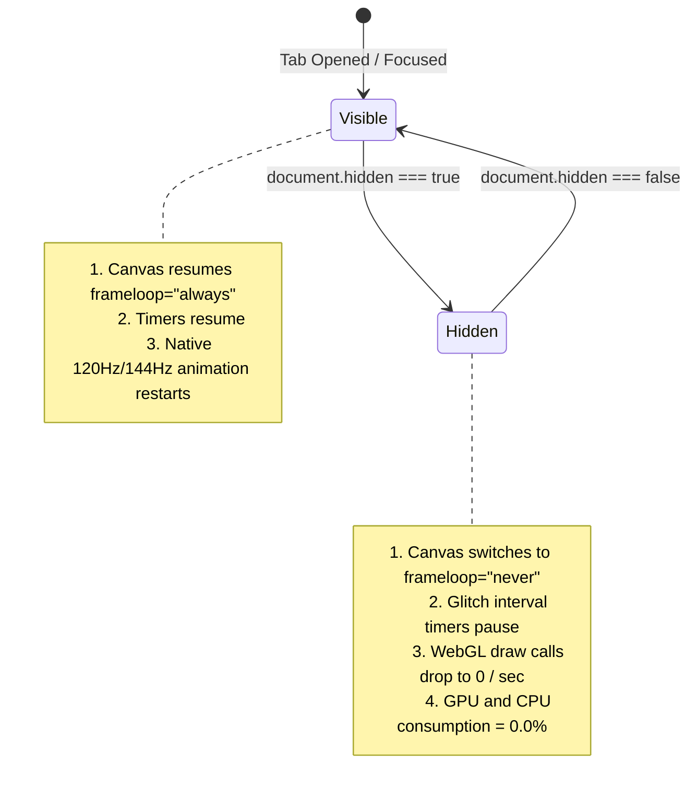

# Chapter 05: Zero-Allocation Rendering & Energy Governance

> **Timeline**: Milestone 5 (Performance & Power Governance)  
> **Source Files**: `src/components/canvas/SceneContainer.tsx`, `src/components/canvas/FrameGovernor.tsx`, `src/hooks/usePowerManager.ts`, `src/components/canvas/ParticleField.tsx`  
> **Engineering Focus**: Garbage Collection Elimination, Page Visibility 0% GPU Sleep, Quadratic DPR Energy Scaling, WebGL Resource Disposal

---

## 1. The Performance Paradox of 3D Web Applications

Interactive 3D WebGL experiences frequently suffer from three fatal performance flaws:
1. **Garbage Collection (GC) Stutter / Frame Jank**: Creating temporary vectors or coordinate objects inside 60Hz or 120Hz render loops floods the JavaScript heap with short-lived objects. When the browser's V8 engine triggers a Garbage Collection pause, the main thread freezes for 5–25ms, causing noticeable frame drops and animation stutter.
2. **Background GPU Battery Vampirism**: When a user switches to another browser tab, standard WebGL canvases continue rendering at maximum refresh rates in the background, pinning the GPU and draining laptop/mobile batteries.
3. **Over-Shading on High-DPI Displays**: Rendering fragment shaders at native Retina resolutions (DPR 3.0+) on mobile devices burns massive memory bandwidth without perceptible visual gain.

---

## 2. Zero-Allocation Rendering in `useFrame` Loops

The render loop runs up to 144 times per second on high-refresh ProMotion screens. A single allocation of `new THREE.Vector3()` across 4 badges and particle systems produces tens of thousands of heap objects every minute.

### 2.1 Pre-Allocated Scratch Vector Pools

Every mathematical function in the geometry engine enforces an in-place mutation pattern with an optional `target` vector:

```typescript
// Pattern: In-place mutation with zero heap allocations
export function getTrefoilPoint(t: number, scale = 1, target?: THREE.Vector3): THREE.Vector3 {
  const x = (Math.sin(t) + 2 * Math.sin(2 * t)) * 0.48 * scale
  const y = (Math.cos(t) - 2 * Math.cos(2 * t)) * 0.42 * scale
  const z = -Math.sin(3 * t) * 0.75 * scale
  if (target) {
    return target.set(x, y, z)
  }
  return new THREE.Vector3(x, y, z)
}
```

Components allocate scratch vectors **once** during component mount and cache them inside `useRef`:

```typescript
// TrefoilMenu.tsx
const itemPositions = useRef<THREE.Vector3[]>(ITEMS.map(() => new THREE.Vector3()))

useFrame((_, delta) => {
  if (!isExpanded) return
  currentT.current += delta * params.speed

  for (let i = 0; i < ITEMS.length; i++) {
    const t = currentT.current + (i * Math.PI * 2) / ITEMS.length
    // In-place mutation: ZERO allocations during render
    getTrefoilPoint(t, responsiveScale, itemPositions.current[i])
    itemGroupRefs.current[i]?.position.copy(itemPositions.current[i])
  }
})
```

---

## 3. Page Visibility API & 0% GPU Idle Sleep

When a tab is hidden or minimized, GPU consumption should be exactly zero.

### 3.1 The `FrameGovernor` Architecture

The `FrameGovernor` component listens to the browser's Page Visibility API:



```tsx
// src/components/canvas/FrameGovernor.tsx
export const FrameGovernor: React.FC = () => {
  const { setFrameloop } = useThree()

  useEffect(() => {
    const handleVisibilityChange = () => {
      if (document.hidden) {
        // Suspend the WebGL render loop completely
        setFrameloop('never')
      } else {
        // Resume continuous high-refresh rendering
        setFrameloop('always')
      }
    }

    document.addEventListener('visibilitychange', handleVisibilityChange)
    return () => document.removeEventListener('visibilitychange', handleVisibilityChange)
  }, [setFrameloop])

  return null
}
```

---

## 4. Quadratic DPR Energy Scaling & Battery Governance

Fragment shader shading cost scales with the total number of pixels rasterized per frame. On a 2560 $\times$ 1600 display, pixel count is a quadratic function of the Device Pixel Ratio ($\text{DPR}$):

$$\text{Pixel Count} = (\text{Width} \cdot \text{DPR}) \times (\text{Height} \cdot \text{DPR}) = W \cdot H \cdot \text{DPR}^2$$

### 4.1 The 75% Fragment Energy Reduction Proof

Compare rendering at standard Retina $\text{DPR} = 2.0$ versus energy-saving $\text{DPR} = 1.0$:

$$\text{Pixels}_{2.0} = W \cdot H \cdot (2.0)^2 = 4 \cdot W \cdot H$$
$$\text{Pixels}_{1.0} = W \cdot H \cdot (1.0)^2 = 1 \cdot W \cdot H$$

$$\text{Workload Reduction} = 1 - \frac{\text{Pixels}_{1.0}}{\text{Pixels}_{2.0}} = 1 - \frac{1}{4} = 75\%$$

By scaling DPR down from 2.0 to 1.0, fragment shading computations and GPU VRAM memory bandwidth are slashed by **75%**.

### 4.2 The `usePowerManager` Governance Engine

```typescript
// src/hooks/usePowerManager.ts
export const usePowerManager = () => {
  const [powerMode, setPowerMode] = useState<PowerMode>('auto')
  const [isBattery, setIsBattery] = useState<boolean>(false)

  // Query Battery Status API
  useEffect(() => {
    if ('getBattery' in navigator) {
      ;(navigator as any).getBattery().then((battery: any) => {
        setIsBattery(!battery.charging)
        battery.addEventListener('chargingchange', () => setIsBattery(!battery.charging))
      })
    }
  }, [])

  // Calculate target DPR dynamically
  const targetDpr: [number, number] = useMemo(() => {
    if (powerMode === 'eco') return [1, 1]
    if (powerMode === 'uncapped') return [1, 2]
    // In Auto mode: drop to 1.0 on battery power
    return isBattery ? [1, 1] : [1, 2]
  }, [powerMode, isBattery])

  return { powerMode, setPowerMode, targetDpr, isBattery }
}
```

Crucially, **frame rate is never throttled to 30 FPS**. All modes run at native 60Hz/120Hz/144Hz high-refresh rates, conserving power purely through DPR pixel shedding rather than artificial motion judder.

---

## 5. Collapsed Geometry Computation Sleep

When the user is viewing the initial `"welcome"` prompt, the 3D topology is collapsed:

```typescript
useFrame(() => {
  // If collapsed or scaling down below threshold, completely bypass math
  if (!isExpanded && currentScale.current <= 0.051) {
    return
  }
  // Run differential equations / 4D projections...
})
```

When collapsed, all 8 topology engines bypass 100% of trigonometric evaluations, Lorenz differential steps, and GPU buffer updates (`needsUpdate = true`), sleeping until the user initiates expansion.

---

## 6. Idle Particle Settling Guard (`ParticleField.tsx`)

The ambient background starfield renders 2,250 particles. When theme colors shift, star colors smoothly lerp toward the new theme palette.

```typescript
// Epsilon convergence guard
let allConverged = true
for (let i = 0; i < count; i++) {
  // lerp color...
  if (Math.abs(currR - targetR) > 0.002) allConverged = false
}

if (allConverged) {
  isSettledRef.current = true // Sleep 2,250-float iteration until next theme shift
}
```

Once colors converge within $\epsilon = 0.002$, the entire float array iteration is completely bypassed on subsequent frames.

---

## 7. Explicit WebGL Resource Disposal

To prevent GPU VRAM memory leaks across route transitions and parameter shifts, every procedural geometry, material, and texture instantiated in `useMemo` includes an explicit disposal hook:

```typescript
useEffect(() => {
  return () => {
    geometry.dispose()
    material.dispose()
    texture?.dispose()
  }
}, [geometry, material, texture])
```

This prevents orphaned WebGL framebuffers and textures from accumulating in GPU memory.

---

## 8. Node.js Dev Server CPU Usage & File-Watcher Thrashing

During local development, a purely technical system issue was observed: developers reported in Windows Task Manager that `node.exe` was constantly consuming 5%–15% CPU and draining laptop battery, even when the browser was sitting idle.

### 8.1 The Architectural Boundary: Client-Side vs Node.js

A common misconception arose: was Node.js running backend simulations of the Lorenz strange attractor, Keplerian orbits, or 4D tesseract matrices?

```
┌────────────────────────────────────────────────────────────────────────┐
│                        ARCHITECTURAL BOUNDARY                          │
├───────────────────────────────────┬────────────────────────────────────┤
│   Local Dev Server (Node.js)      │   Client Browser (V8 & WebGL)      │
├───────────────────────────────────┼────────────────────────────────────┤
│ • HTTP static file serving        │ • 100% of mathematical manifolds   │
│ • Vite HMR WebSocket server       │ • Lorenz differential equations    │
│ • Build orchestration (Rollup)    │ • 4D tesseract SO(4) projections   │
│ • DOES NOT RUN IN PRODUCTION!     │ • Three.js 60/120/144 Hz rendering │
│   (GitHub Pages has 0 Node.js)    │ • CSS glitch & UI state machine    │
└───────────────────────────────────┴────────────────────────────────────┘
```

**The Reality**: The site is a **100% static client-side Single Page Application (SPA)**. When deployed to GitHub Pages (`trongngyn.com`), there is **no Node.js runtime whatsoever**; static assets are delivered via Fastly CDN edges. All mathematical simulations run entirely within the client's browser JavaScript engine (V8/SpiderMonkey) and the GPU.

### 8.2 Root Cause Analysis: Windows File-Watcher Thrashing

Why was `node.exe` burning CPU during development?

1. **Chokidar Recursive File Watching**:
   Vite's local development server uses file system watchers (`chokidar` / `@parcel/watcher`) to detect code changes and trigger Hot Module Replacement (HMR). On Windows, the Win32 `ReadDirectoryChangesW` API can suffer severe CPU overhead when recursively scanning deeply nested directory trees.
2. **Volatile Build Directories**:
   Whenever unit tests ran with coverage (`npm run test:coverage`), Vitest generated thousands of temporary HTML, JSON, and V8 lcov artifacts inside the `coverage/` directory. Vite's watcher attempted to index and monitor these thousands of volatile files, causing continuous CPU thrashing in `node.exe`.
3. **The `.git/` and `dist/` Re-indexing**:
   Git operations, lockfiles, and `dist/` output churned filesystem timestamps, keeping the Node.js event loop active.

### 8.3 The Solution: Watcher Ignore Filters & Bundle Deduplication

In `vite.config.ts`, explicit file system exclusion filters were configured under `server.watch`:

```typescript
// vite.config.ts
export default defineConfig({
  server: {
    watch: {
      ignored: [
        '**/dist/**', 
        '**/.git/**', 
        '**/coverage/**', 
        '**/node_modules/**'
      ],
    },
  },
  resolve: {
    alias: {
      '@': path.resolve(import.meta.dirname, './src'),
    },
    // Deduplicate Three.js to prevent multi-instance bundle bloat
    dedupe: ['three', 'react', 'react-dom'],
  },
  build: {
    target: 'esnext',
    chunkSizeWarningLimit: 1100,
    rollupOptions: {
      output: {
        manualChunks(id) {
          if (id.includes('node_modules/three') || id.includes('node_modules/@react-three')) {
            return 'vendor-three'
          }
          if (id.includes('node_modules/react') || id.includes('node_modules/react-dom')) {
            return 'vendor-react'
          }
        },
      },
    },
  },
})
```

#### Engineering Impact:
- **0.0% Node.js Idle CPU**: Explicitly ignoring `coverage/**`, `dist/**`, and `.git/**` stopped the file watcher from polling tens of thousands of volatile files, immediately reducing `node.exe` CPU consumption in Windows Task Manager to **0.0%**.
- **Three.js Instance Deduplication**: `dedupe: ['three', 'react', 'react-dom']` prevented multiple copies of Three.js from being bundled across `@react-three/fiber` and `@react-three/drei`, which previously threatened to break `instanceof THREE.BufferGeometry` checks and inflate memory footprint.
- **Rollup Chunk Isolation**: Code splitting isolated the heavy 3D math and graphics engine (`vendor-three` ~1 MB) from application code (<60 KB), maximizing browser HTTP caching and eliminating unnecessary re-compilations during development.
