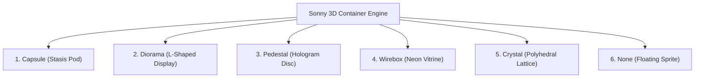

# Chapter 06: Sonny 3D Character Containers & Turntable Animation

> **Timeline**: Milestone 6 (3D Character Badges & Flipbook Turntable)  
> **Source Files**: `src/components/canvas/geometries/MenuItemBadge.tsx`, `src/context/SonnyContainerContext.tsx`  
> **Engineering Focus**: 2.5D Sprite Integration, 3D Architectural Containers, High-Framerate Flipbook Animation, Zero-Re-render Texture Swapping

---

## 1. The Challenge: Integrating 2D Character Sprites into 3D Space

The `/sonny` navigation item references Sonny, a stylized 3D character. In typical 3D web applications, developers either load an enormous 10–30 MB GLTF/GLB model (which severely degrades mobile load times and requires heavy skeleton vertex skinning) or slap a flat billboard PNG into the 3D scene (which looks paper-thin, un-integrated, and amateurish).

### The Dual Requirements:
1. **Physical Spatial Grounding**: The character sprite needed structural 3D architectural vessels to give it depth, physical grounding, and shadows within the mathematical scene.
2. **Interactive 360° Turntable Rotation**: Hovering or triggering a glitch burst had to initiate a smooth 360° rotating turntable spin without triggering React re-renders or GC memory allocations.

---

## 2. The 6 Architectural 3D Containers

`MenuItemBadge.tsx` implements **6 switchable 3D container styles**, switchable in real time via the Tuner HUD or console:



### 2.1 Container Anatomy & Specifications

| Container ID | Dimensions | Geometry Components | Materials & Visual Physics |
| :--- | :--- | :--- | :--- |
| **`capsule`** *(Default)* | $r=0.28, h=0.78$ | Upper & lower metallic end-cap cylinders, central translucent cylinder shell, dual glowing neon mounting ring brackets. | `glassMaterial` with opacity $0.16$, `depthWrite: false` for transparency; metallic caps with solid primary theme color. |
| **`diorama`** | Back: $0.39 \times 0.69$<br>Floor: $0.39 \times 0.39$ | Vertical back wall planar mesh coupled orthogonally to a horizontal floor platform at $z=0.19$. | Solid primary color background creating backdrop depth and floor perspective shadows. |
| **`pedestal`** | Disc: $r=0.24$<br>Ring: $r=0.245$ | Flat horizontal circular cylinder disc base surrounded by an outer glowing concentric neon torus emitter ring. | Concentric emitter ring pulses with highlight color; no vertical back walls to obstruct view. |
| **`wirebox`** | $0.44 \times 0.72 \times 0.44$ | Orthogonal 3D wireframe box with 12 neon edges surrounding the character sprite. | Pure 90° orthogonal cyber vitrine matching the GPU glitch aesthetic. |
| **`crystal`** | $r=0.42, 20\text{ faces}$ | Translucent icosahedral crystal cage with glowing gem lattice wireframe and semi-transparent crystal facets. | Double-pass rendering: outer gem wireframe with translucent inner facet refraction. |
| **`none`** | $0.39 \times 0.69$ | Pure character sprite plane with zero surrounding geometry. | Pure floating holographic billboard sprite. |

---

## 3. High-Framerate Flipbook Turntable Animation

To achieve fluid 360° character rotation without loading an expensive 3D mesh model, a 15-frame turntable sequence was rendered:
`/images/sonny/frame-01.png` $\dots$ `/images/sonny/frame-15.png`

### 3.1 The Zero-Re-Render Animation Loop

In React, the standard pattern for animating frames is updating state via `setFrame(f => (f + 1) % 15)`. 
**Why this fails in WebGL**: Calling `setState` 22 times per second triggers 22 full React reconciliation tree traversals, destroying frame rates, generating garbage collection churn, and introducing visible micro-stutter.

#### The Production Solution: Direct Three.js Texture Pointer Mutation
1. All 15 textures are preloaded into memory on component mount via `THREE.TextureLoader`.
2. A high-frequency timer tracks frame indices independently in a `useRef` scalar.
3. Every 45ms, the active Three.js mesh material's texture map pointer is directly swapped in-place:

```typescript
// MenuItemBadge.tsx: Direct texture pointer swapping
useEffect(() => {
  if (!isImageBadge) return
  const isGlitchedOrHovered = isGlitching || isHovered

  if (isGlitchedOrHovered) {
    frameIntervalRef.current = window.setInterval(() => {
      frameIndexRef.current = (frameIndexRef.current + 1) % frameTextures.length
      const activeTexture = frameTextures[frameIndexRef.current]

      if (spriteMaterialRef.current && activeTexture) {
        // Direct Three.js material mutation (ZERO React re-renders!)
        spriteMaterialRef.current.map = activeTexture
        spriteMaterialRef.current.needsUpdate = true
      }
    }, 45) // Synchronized 45ms frame interval (~22.2 FPS)
  } else {
    // When idle, immediately reset to front-facing frame 0
    if (frameIntervalRef.current) clearInterval(frameIntervalRef.current)
    frameIndexRef.current = 0
    if (spriteMaterialRef.current && frameTextures[0]) {
      spriteMaterialRef.current.map = frameTextures[0]
      spriteMaterialRef.current.needsUpdate = true
    }
  }

  return () => {
    if (frameIntervalRef.current) clearInterval(frameIntervalRef.current)
  }
}, [isHovered, isGlitching, isImageBadge, frameTextures])
```

### 3.2 Visual State Transition Guarantees

1. **Deterministic Front-Facing Idle**: When the user's cursor leaves the badge, the turntable animation halts immediately, resetting the sprite to `frame-01.png` (the canonical front-facing portrait pose).
2. **Unified Hover & Glitch Dynamics**: During periodic GPU glitch bursts, Sonny automatically begins spinning in sync with the visual distortion, creating a cohesive cyber event.
3. **Micro-Jitter Displacement**: On hover and glitch, the container executes subtle orthogonal micro-twitches ($[-0.02, +0.02]$ units), enhancing tactile responsiveness.
