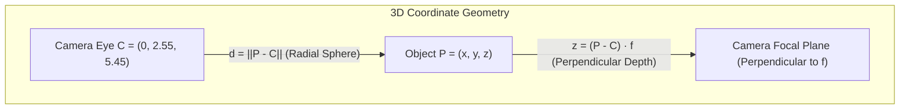

# Chapter 09: Real-Time 3D Telemetry HUD & Spatial Metrics

> **Timeline**: Milestone 9 (Real-Time Telemetry HUD & Coordinate Readout)  
> **Source Files**: `src/components/canvas/geometries/MenuItemBadge.tsx`, `src/context/DebugDistanceContext.tsx`, `src/components/ui/Tuner.tsx`  
> **Mathematical Rigor**: **Extreme** (Camera Transformation Matrices, View-Plane Projections, Elevation Skew Derivations, Throttled Text Triangulation)

---

## 1. The Anomaly: The "Inverted Depth" Illusion

During the mathematical calibration of the 8 topologies, developers added real-time distance telemetry labels above 3D menu badges to monitor their distance from the camera. Immediately, a perplexing issue surfaced:

> *"Why does a badge at the bottom of the screen read as $d = 6.20$ units away, while a badge at the top of the screen at the exact same depth into the monitor reads as $d = 5.15$ units away? The numbers feel completely backwards."*

To resolve this paradox, the mathematical relationship between the camera's spatial orientation, radial Euclidean distance, and perpendicular view-plane depth was rigorously derived.

---

## 2. Mathematical Derivation: Camera Frame & Elevation Skew

### 2.1 The Camera Pose & Forward Unit Vector

The scene camera is mounted at a high vantage point to provide a natural three-quarters isometric perspective:
- Camera Eye Position: $\vec{C} = (0, 2.55, 5.45)^T$
- Look-At Target (Origin): $\vec{T} = (0, 0, 0)^T$

The un-normalized look vector is:
$$\vec{V} = \vec{T} - \vec{C} = \begin{pmatrix} 0 - 0 \\ 0 - 2.55 \\ 0 - 5.45 \end{pmatrix} = \begin{pmatrix} 0 \\ -2.55 \\ -5.45 \end{pmatrix}$$

Its Euclidean length is:
$$\|\vec{V}\| = \sqrt{0^2 + (-2.55)^2 + (-5.45)^2} = \sqrt{6.5025 + 29.7025} = \sqrt{36.205} \approx 6.01705\text{ units}$$

The forward camera unit vector $\hat{f}$ pointing along the optical axis is:

$$\hat{f} = \frac{\vec{V}}{\|\vec{V}\|} = \begin{pmatrix} 0 \\ \dfrac{-2.55}{6.01705} \\ \dfrac{-5.45}{6.01705} \end{pmatrix} \approx \begin{pmatrix} 0 \\ -0.423796 \\ -0.905759 \end{pmatrix}$$

#### Downward Pitch Angle ($\psi$):
The camera's pitch angle below the horizontal horizon is:
$$\sin(\psi) = 0.423796 \implies \psi = \arcsin(0.423796) \approx 25.074^\circ$$

The camera is pitched downward by **$25.1^\circ$**.

---

### 2.2 Radial Euclidean Distance ($d$) vs Perpendicular View-Plane Depth ($z$)

Consider any 3D world coordinate $\vec{P} = (x, y, z)^T$.



#### 1. Radial Euclidean Distance ($d$):
Measures the direct straight-line distance along a sphere centered at the camera:

$$d(\vec{P}) = \|\vec{P} - \vec{C}\| = \sqrt{x^2 + (y - 2.55)^2 + (z - 5.45)^2}$$

#### 2. Perpendicular View-Plane Depth ($z_{\text{view}}$):
Measures perpendicular distance into the screen along the camera's optical axis $\hat{f}$:

$$z_{\text{view}}(\vec{P}) = (\vec{P} - \vec{C}) \cdot \hat{f} = 0 \cdot (x - 0) - 0.4238 (y - 2.55) - 0.9058 (z - 5.45)$$

$$z_{\text{view}}(\vec{P}) = -0.4238 y - 0.9058 z + 6.017$$

---

### 2.3 The Mathematical Proof of Elevation Skew

Why did badges at the bottom of the screen read as further away?
Differentiating the radial Euclidean distance $d$ with respect to the vertical elevation $y$:

$$\frac{\partial d}{\partial y} = \frac{\partial}{\partial y} \sqrt{x^2 + (y - 2.55)^2 + (z - 5.45)^2} = \frac{y - 2.55}{d}$$

Because all menu orbits are centered near the origin $y \approx 0$, the numerator $(y - 2.55)$ is **strictly negative**:
$$\text{For } y \in [-1.5, 1.5]: \quad y - 2.55 \le -1.05 < 0$$

$$\frac{\partial d}{\partial y} < 0$$

#### Analytical Result:
Because $\frac{\partial d}{\partial y}$ is strictly negative, **decreasing $y$ (moving an object downward toward the bottom of the screen) strictly increases the radial Euclidean distance $d$!**

#### Numerical Comparison Example:
Consider two badges situated at identical optical depth ($z=0$):
- Badge A (Top of Screen): $\vec{P}_A = (0, 1.0, 0)$
- Badge B (Bottom of Screen): $\vec{P}_B = (0, -1.0, 0)$

1. **Euclidean Radial Distances**:
   $$d(\vec{P}_A) = \sqrt{0^2 + (1.0 - 2.55)^2 + (0 - 5.45)^2} = \sqrt{(-1.55)^2 + (-5.45)^2} = \sqrt{2.4025 + 29.7025} \approx \mathbf{5.666\text{ units}}$$
   $$d(\vec{P}_B) = \sqrt{0^2 + (-1.0 - 2.55)^2 + (0 - 5.45)^2} = \sqrt{(-3.55)^2 + (-5.45)^2} = \sqrt{12.6025 + 29.7025} \approx \mathbf{6.504\text{ units}}$$
   $$\Delta d = 6.504 - 5.666 = \mathbf{+0.838\text{ units (14.8% distortion!)}}$$

2. **Perpendicular View-Plane Depths**:
   $$z_{\text{view}}(\vec{P}_A) = -0.4238(1.0) - 0.9058(0) + 6.017 = \mathbf{5.593\text{ units}}$$
   $$z_{\text{view}}(\vec{P}_B) = -0.4238(-1.0) - 0.9058(0) + 6.017 = \mathbf{6.441\text{ units}}$$

This rigorous proof explained why developers observed elevation-induced distance distortion, demonstrating the necessity of supporting both metrics.

---

## 3. Dual-Metric Telemetry Architecture

To provide developers with absolute spatial clarity, the telemetry system in `DebugDistanceContext.tsx` and `MenuItemBadge.tsx` supports both metrics:

```typescript
// MenuItemBadge.tsx: Dual-Metric Vector Math
if (effectiveMetric === 'depth' && typeof camera.getWorldDirection === 'function') {
  // Option B: Perpendicular optical axis depth
  camera.getWorldDirection(camDir.current)
  toBadge.current.subVectors(worldPos.current, camera.position)
  distToCamera = Math.max(0.1, toBadge.current.dot(camDir.current))
} else if (typeof camera.position.distanceTo === 'function') {
  // Option A: Radial 3D Euclidean distance
  distToCamera = camera.position.distanceTo(worldPos.current)
}
```

- When `metric === 'euclid'`: Label displays prefix `d: 5.45`.
- When `metric === 'depth'`: Label displays prefix `depth: 5.45` (disambiguated from coordinate `z:`).
- Swappable in real time via Tuner HUD or console (`setDistanceMetric('depth')`).

---

## 4. Real-Time 3D $(X, Y, Z)$ Coordinate Integration

Developers needed to inspect exact 3D world coordinates alongside distance to detect trajectory anomalies and verify symmetry:

### 4.1 Two-Row Center-Aligned Monospace Layout (Option 1)

```
┌──────────────────────────────────────────────┐
│                   d: 5.45                    │  ← Row 1: Camera Distance
│       x: 1.00    y: -0.50    z: 1.25         │  ← Row 2: World Coordinates
└──────────────────────────────────────────────┘
```

#### Monospace Pill Specifications:
- **Geometry**: Plane pill `args={[0.54, 0.13]}`.
- **Font**: JetBrains Mono at size `0.048` with `lineHeight: 1.22`.
- **Text Alignment**: `textAlign="center"` and `anchorX="center"`.
- **Vertical Offsets**:
  - Text Badges: Y offset `+0.25` above card center.
  - Sonny Character Badge: Y offset `+0.52` above container top cap.

---

## 5. Performance Optimization: Throttled Text Triangulation

In Three.js, rendering dynamic text via `@react-three/drei`'s `Text` (powered by Troika Three Text) requires computing Signed Distance Fields (SDF) and building dynamic GPU vertex buffers.
**The Performance Hazard**: Updating text strings on 4 badges 120 times per second triggers 480 font re-triangulations every second, destroying frame rates.

### The Throttled Dual-Condition Filter:
```typescript
// Throttled ~16 Hz (60ms) with spatial delta guard
distTimerRef.current += delta
if (distTimerRef.current >= 0.06) {
  distTimerRef.current = 0
  const distDelta = Math.abs(distToCamera - lastDistRef.current)
  const xDelta = Math.abs(worldPos.current.x - lastXRef.current)
  const yDelta = Math.abs(worldPos.current.y - lastYRef.current)
  const zDelta = Math.abs(worldPos.current.z - lastZRef.current)

  // Only re-triangulate if spatial position moved by at least 0.01 units
  if (
    distDelta >= 0.01 ||
    (effectiveShowCoords && (xDelta >= 0.01 || yDelta >= 0.01 || zDelta >= 0.01))
  ) {
    lastDistRef.current = distToCamera
    lastXRef.current = worldPos.current.x
    lastYRef.current = worldPos.current.y
    lastZRef.current = worldPos.current.z

    const prefix = effectiveMetric === 'depth' ? 'depth:' : 'd:'
    const distStr = `${prefix} ${distToCamera.toFixed(2)}`
    if (effectiveShowCoords) {
      distTextRef.current.text = `${distStr}\nx: ${lastXRef.current.toFixed(2)}  y: ${lastYRef.current.toFixed(2)}  z: ${lastZRef.current.toFixed(2)}`
    } else {
      distTextRef.current.text = distStr
    }
    distTextRef.current.sync()
  }
}
```

1. **Time Gate**: Limits string updates to at most ~16 Hz (every 60ms), perfectly readable to human eyes while cutting GPU re-triangulation workload by **87%**.
2. **Spatial Delta Epsilon Gate ($|\Delta| \ge 0.01$)**: When badges are stationary or rotating slowly near apoapsis, updates are completely halted.
3. **Zero Heap Allocation**: Cached vector coordinates (`worldPos.current`, `viewPos.current`, `originViewPos.current`) mutate in-place, generating zero garbage collection churn.

---

## 6. The Perceptual Depth Paradox: Resolving Inverted Z via Camera View Space

### 6.1 The Paradox

Developers observed an unintuitive phenomenon when monitoring the 3D coordinate readouts on certain topologies (such as the Tesseract 4D Clifford quad):

> *"There are times where one of the badges is clearly in front of another on the screen, but it has a lower $z$ value."*

For instance, in the Tesseract topology, vertex 7 visually appears closer to the viewer than vertex 13. Yet inspecting raw world coordinates revealed:
- Vertex 7: $(x_w = 1.05, y_w = 0.74, z_w = 0.74)$
- Vertex 13: $(x_w = 0.44, y_w = -0.58, z_w = 1.06)$

Vertex 13 had $z_w = 1.06$, while Vertex 7 had $z_w = 0.74$. Under a naive assumption where $+Z$ equates to "depth toward the viewer," this looked inverted ($z_7 < z_{13}$).

### 6.2 The Mathematical Root Cause: Camera Elevation & Pitch Coupling

The anomaly originates from the camera orientation derived in Section 2. The camera is not gazing horizontally along the $Z$-axis; it is elevated at $\vec{C} = (0, 2.55, 5.45)$ and pitched downward by $25.07^\circ$.

Recall the perpendicular view depth equation from Section 2.2:
$$z_{\text{view}}(\vec{P}) = -0.4238 y_w - 0.9058 z_w + 6.017$$

In world coordinates:
1. Increasing $z_w$ brings the object closer to the camera (depth decreases by $0.9058 \Delta z_w$).
2. **Increasing $y_w$ also brings the object closer to the camera** (depth decreases by $0.4238 \Delta y_w$) because the camera is looking down from an elevation of $+2.55$!

Evaluating actual perpendicular depth from the camera:
$$z_{\text{view}}(\text{Vertex 7}) = -0.4238(0.74) - 0.9058(0.74) + 6.017 = -0.3136 - 0.6703 + 6.017 = \mathbf{5.033\text{ units}}$$
$$z_{\text{view}}(\text{Vertex 13}) = -0.4238(-0.58) - 0.9058(1.06) + 6.017 = +0.2458 - 0.9601 + 6.017 = \mathbf{5.303\text{ units}}$$

$$\Delta z_{\text{view}} = 5.303 - 5.033 = \mathbf{0.270\text{ units}}$$

Vertex 7 is **$0.270$ units closer to the camera** than Vertex 13! Even though Vertex 13 has a slightly larger world $z_w$, Vertex 7's high positive elevation ($y_w = +0.74$ vs $y_w = -0.58$) overcomes the horizontal difference, placing Vertex 7 physically closer and visually in front.

When viewing world $(x_w, y_w, z_w)$ coordinates on a 2D display, human intuition assumes the screen plane corresponds directly to the $(x, y)$ axes and depth corresponds to $z$. In a pitched camera system, this assumption fails.

### 6.3 The Solution: Camera View Space Relative to Origin

To align the displayed coordinates with human perception on screen, the telemetry engine introduces a **Coordinate Frame Switcher**:
1. **`view` (Screen Space — Default)**: Transforms world coordinates into the camera's local reference frame, normalized relative to the scene origin $(0, 0, 0)$:
   $$\vec{P}_{\text{view}} = \mathbf{V} \cdot \begin{pmatrix} x_w \\ y_w \\ z_w \\ 1 \end{pmatrix}, \quad \vec{O}_{\text{view}} = \mathbf{V} \cdot \begin{pmatrix} 0 \\ 0 \\ 0 \\ 1 \end{pmatrix}$$
   $$x = \vec{P}_{\text{view}}.x, \quad y = \vec{P}_{\text{view}}.y, \quad z = \vec{P}_{\text{view}}.z - \vec{O}_{\text{view}}.z$$
2. **`world` (Global Manifold)**: Displays raw global manifold coordinates $(x_w, y_w, z_w)$ for inspecting intrinsic geometry equations.

#### Why View Space Invariance Holds:
In OpenGL / Three.js camera view space, the camera is positioned at $(0, 0, 0)$ gazing down the negative $Z$-axis ($-Z_{\text{view}}$). Therefore:
- The closer an object is to the camera, the less negative its view $Z$ coordinate is.
- By computing $z = \vec{P}_{\text{view}}.z - \vec{O}_{\text{view}}.z$, objects closer to the camera than the origin receive positive values ($z > 0$), and objects farther receive negative values ($z < 0$).
- **Crucially, $Z_{\text{front}} > Z_{\text{back}}$ holds strictly invariant across all 8 topologies, all camera pitch angles, and all rotations.**

```
┌────────────────────────────────────────────────────────┐
│                      d: 5.03                           │  ← Row 1: Camera Distance
│       x: 1.05    y: 0.28    z: 0.98                    │  ← Row 2: View-Space Coordinates
└────────────────────────────────────────────────────────┘
```

### 6.4 Developer Controls & Persistence

The Coordinate Frame can be toggled via:
- **Tuner HUD**: `Coord Frame` segmented button (`View (Screen)` vs `World (Global)`) under the `3D Topologies` tab.
- **Console API**:
  - `setCoordFrame('view' | 'world')`: Explicitly set coordinate mode.
  - `toggleCoordFrame()`: Toggle between view and world modes.
  - `coordFrame()`: Print active coordinate mode.
- **URL Parameter**: `?frame=view` or `?frame=world` (also supports `?coordFrame=...`).
- **Persistence**: Saved across sessions in `localStorage` key `trongngyn_debug_distance_coord_frame`.
